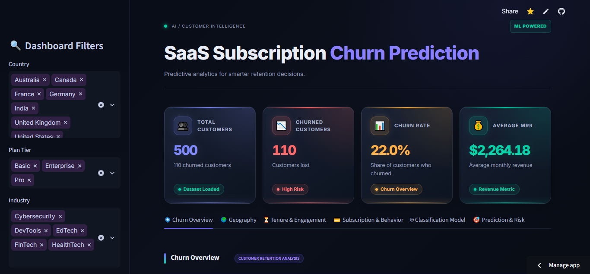

<div align="center">

# SaaS Subscription Churn Prediction

**Which customers leave, and can we see it coming?**
Cleaning → exploration → a Gradient Boosting classifier → a six-tab Streamlit dashboard.

[](https://saas-churn-prediction719.streamlit.app)




</div>

---

## What this project does

I built this during my internship at Naviotech Solution Pvt. Ltd. It takes a five-table SaaS dataset (500 accounts, 110 churned) and answers two questions:

1. **Where does churn happen?** Plan, country, industry, tenure and subscription behaviour, shown in an interactive dashboard.
2. **Can a model flag at-risk accounts?** A Gradient Boosting classifier trained only on information available *before* a prediction date.

## Results

Final model: Gradient Boosting, decision threshold 0.40, scored once on a held-out **test** set (100 accounts, 22 churned).

| Accuracy | Precision | Recall | F1 | ROC-AUC |
|---|---|---|---|---|
| 0.900 | 0.800 | 0.727 | 0.762 | 0.876 |

Confusion matrix: 74 true negatives, 4 false positives, 6 false negatives, 16 true positives.

Model choice was made on a separate **validation** set (0.50 cutoff):

| Model | Accuracy | Precision | Recall | F1 | ROC-AUC |
|---|---|---|---|---|---|
| Logistic Regression | 0.710 | 0.370 | 0.455 | 0.408 | 0.686 |
| Random Forest | 0.850 | 0.818 | 0.409 | 0.545 | 0.810 |
| **Gradient Boosting** | 0.900 | 0.929 | 0.591 | 0.722 | 0.805 |

> Validation and test numbers use different accounts and thresholds, so they are not directly comparable.

Top features by importance: average MRR (52.8%), auto-renew count (15.2%), tenure months (14.6%).

## What the data shows

These are associations in the dataset, not causes.

- Churn is about 22% in every plan tier (21.9% to 22.1%), so plan alone doesn't separate churners.
- Higher-churn segments: DevTools (31.0%), event-referred accounts (30.2%), Germany (32%, only 25 accounts), trial accounts (25.8% vs 21.1%).
- Retained accounts average $2,315 MRR vs $2,083 for churned ones.

## How it works

```
Kaggle CSVs ─► 01 cleaning ─► 02 EDA ─► account_data.csv ─┐
                                   │                      ├─► Streamlit app
                           04 modelling ─► models/ + outputs/ ─┘
```

- **No leakage by design:** each account gets a prediction date (end of data for retained accounts, first churn event minus 30 days for churned ones). Features only use records up to that date.
- **Split:** stratified 60/20/20, `random_state=42`.
- **Pipeline:** median imputation for numbers, most-frequent imputation + one-hot encoding for categories, then the model, all inside one scikit-learn `Pipeline`.
- **Threshold:** picked on validation by best F1 (0.40).

## Dashboard

| Tab | What you get |
|---|---|
| Churn Overview | churn split, churn by plan tier |
| Geography | churn by country, country × plan heatmap |
| Tenure & Engagement | churn by tenure group, usage and satisfaction |
| Subscription & Behavior | MRR and upgrade/downgrade comparison |
| Classification Model | candidate comparison, confusion matrix, feature importance |
| Prediction & Risk | per-account probability with HIGH / MEDIUM / LOW band |

Sidebar filters: Country, Plan Tier, Industry.

## Documentation

- [Project report (PDF)](documentation/SaaS_Churn_Prediction_Project_Report.pdf)
- [Presentation (PDF)](documentation/SaaS_Churn_Prediction_Presentation.pdf)

## Run it locally

```bash
git clone https://github.com/Pratham719/saas-churn-prediction.git
cd saas-churn-prediction
pip install -r requirements.txt
streamlit run app.py
```

`scikit-learn` is pinned to 1.8.0 because the saved model was created with that version.

## Repository

```
saas-churn-prediction/
├── app.py                  # Streamlit dashboard
├── requirements.txt
├── LICENSE
├── README.md
├── assets/
│   └── dashboard_top.png   # README screenshot
├── documentation/
│   ├── SaaS_Churn_Prediction_Project_Report.pdf
│   ├── SaaS_Churn_Prediction_Presentation.pdf
│   ├── SaaS_Churn_Prediction_Project_Report.docx
│   └── SaaS_Churn_Prediction_Presentation.pptx
├── .streamlit/
│   └── config.toml         # app theme
├── data/
│   ├── original/           # raw RavenStack CSVs (5 tables)
│   └── cleaned/            # cleaned tables + account_data.csv
├── notebooks/
│   ├── 01_Cleaning.ipynb
│   ├── 02_EDA.ipynb
│   ├── 03_Classification.ipynb              # earlier iteration
│   └── 04_Classification_Evaluation.ipynb   # final modelling run
├── models/
│   ├── churn_model.pkl
│   └── churn_threshold.pkl
└── outputs/
    ├── confusion_matrix.csv
    ├── feature_importance.csv
    └── test_metrics.csv
```

Notebook 04 is the final modelling run. Notebook 03 is an earlier iteration kept for history.

## Limitations

- Only 22 churned accounts in the test set, so the metrics are noisy.
- Churned accounts with no churn event have missing behavioural features. That pattern appears only among churners and likely lifts recall, so 0.727 is probably optimistic.
- The Prediction & Risk tab scores accounts with whole-history features, unlike training. It demonstrates the output, not model accuracy.
- The dataset is synthetic, so results won't necessarily hold for real customers.

## Data

[RavenStack SaaS Subscription & Churn Analytics](https://www.kaggle.com/datasets/rivalytics/saas-subscription-and-churn-analytics-dataset) by River @ Rivalytics on Kaggle.

## Tech Stack


## Author

**Pratham Rangoonwala**

[](https://pratham719.github.io/Portfolio/)
[](https://www.linkedin.com/in/pratham-ds)
[](https://share.streamlit.io/user/pratham719)